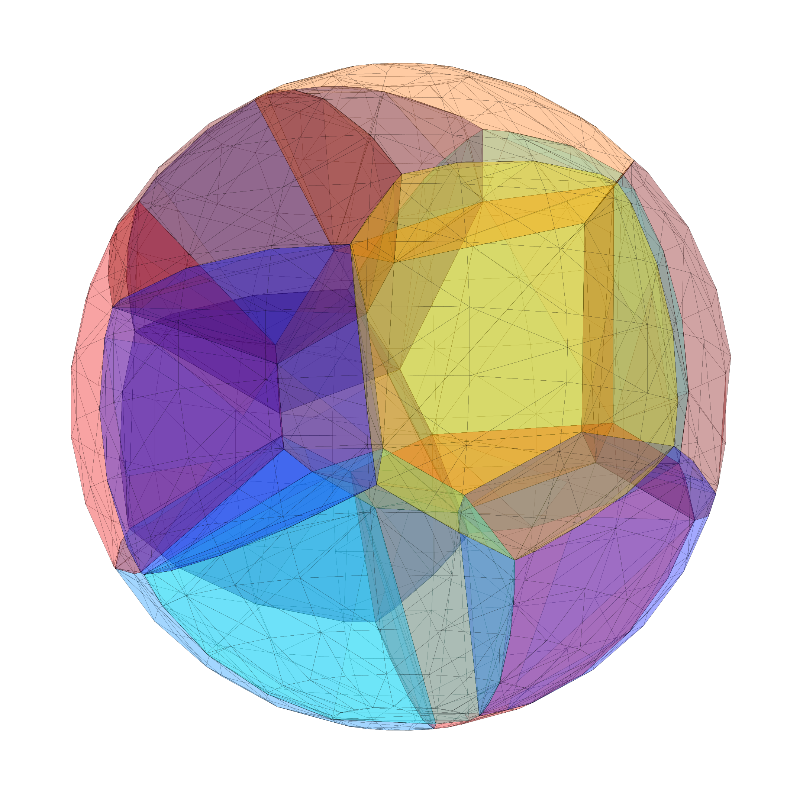
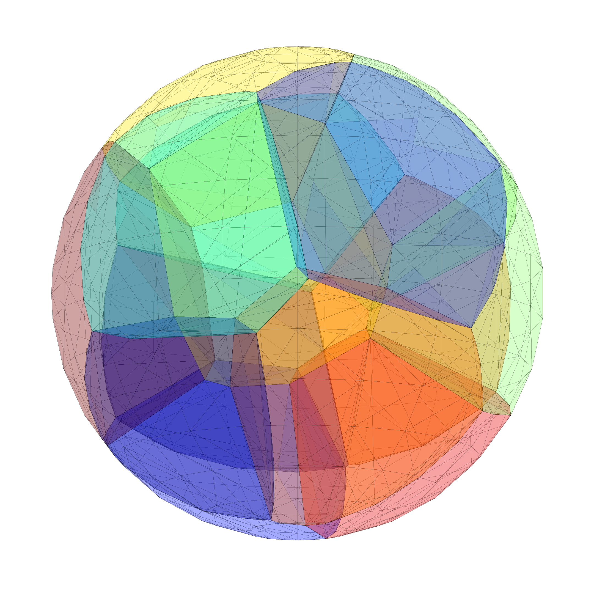
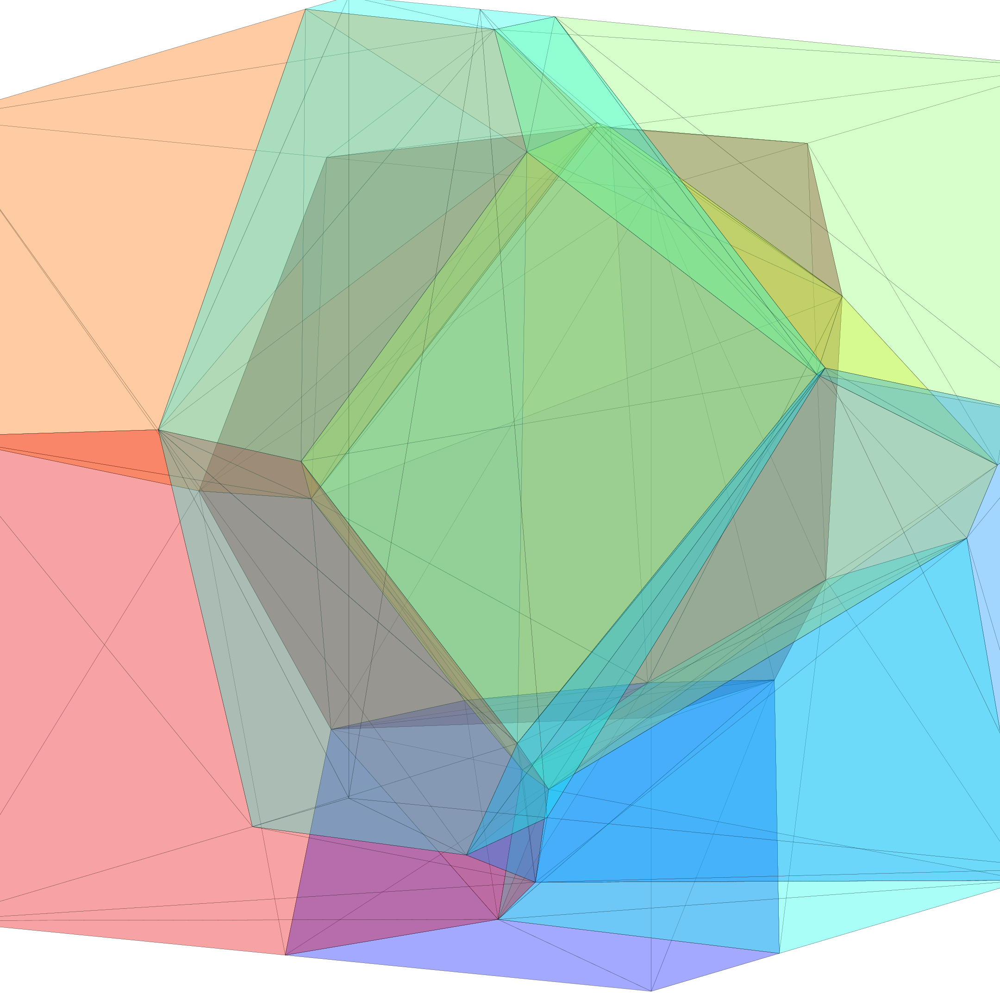
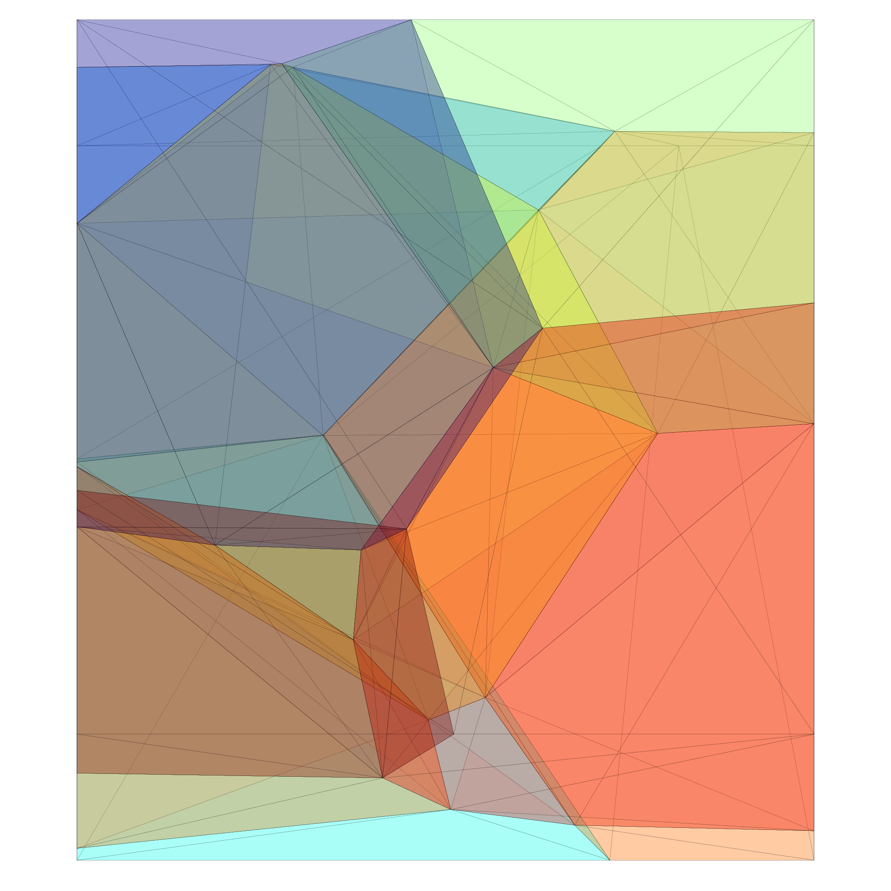

# Voronoi 3D
This code allows the construction of bounded 3D Voronoi diagrams inside an arbitrary polytope. 

Given a set of seeds, the code first constructs the corresponding Delaunay triangulation using an iterative insertion flipping algorithm. Next, the dual Voronoi diagram is extracted. It is implemented in such a way that the Voronoi diagram is automatically bounded inside a specified polytope.


<p align="center">


</p>
<p align="center">


</p>


## Complex example
In the following example, we see how the code has been used to generate secondary pulmonary lobules inside a lung geometry.

<p align="center">


</p>

## Usage
An example of how to use this is found in *example/*.

From *example/*, compile using:
```
cmake -S . -b build
cmake --build build
```
Then you may run from *example/build/* the *.example* executable.

The high-level interface is in *include/vor3d.h*. Build a domain once (`vor3d_domain_from_trimesh`, `vor3d_domain_from_convh` or `vor3d_domain_from_points`), then call `vor3d_diagram` with an array of seeds (and optional weights for a power/Laguerre diagram). The library detects whether the domain is convex and picks the clip kernel itself: convex domains use a fast direct clip, non-convex ones a constrained tetrahedralization of the interior. The output is the `s_vdiagram` structure, also in *include/vor3d.h*. Seeds are not filtered by position; use `vor3d_domain_contains` to keep only interior seeds.

The Delaunay / regular triangulation of a point set (`delaunay_3d`) and the constrained tetrahedralization of a closed mesh's interior (`tetrahedralize_trimesh`) are in *include/delaunay.h*; both return an `s_tetmesh` (flat tets, per-face neighbours, positively oriented).

## Known limitations
- **Misaligned `double` accesses in the vendored implicit predicates** (`external/geometry/external/implicit_predicates`, Attene's indirect predicates). Its expansion memory pool (`memPool.h`, `MultiPool`) prefixes every block with a 4-byte header and returns the address after it, so `double` arrays taken from the pool start 4 bytes off an 8-byte boundary. This only happens on the slow exact fallback (near-degenerate inputs whose expansions outgrow 32 doubles). Results are unaffected and Apple Silicon / x86-64 handle unaligned `double` loads and stores in hardware, but it is undefined behaviour in C/C++: UBSan reports it (`numerics.hpp`, `expansionObject::Sub_product`), so sanitizer runs need `-fno-sanitize=alignment`, and it could fault on a strict-alignment platform. Fix if ever needed: an 8-byte block header in `memPool.h`.

### References
Source for the Delaunay algorithm: *Computing the 3D Voronoi Diagram Robustly: An Easy Explanation. Hugo Ledoux.*
